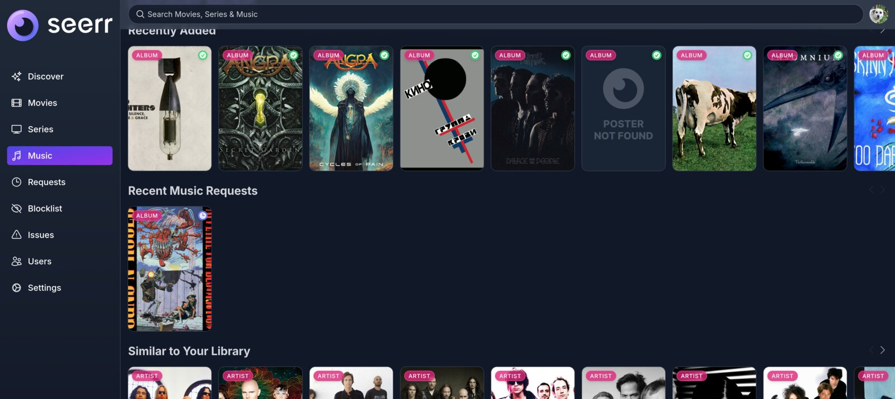
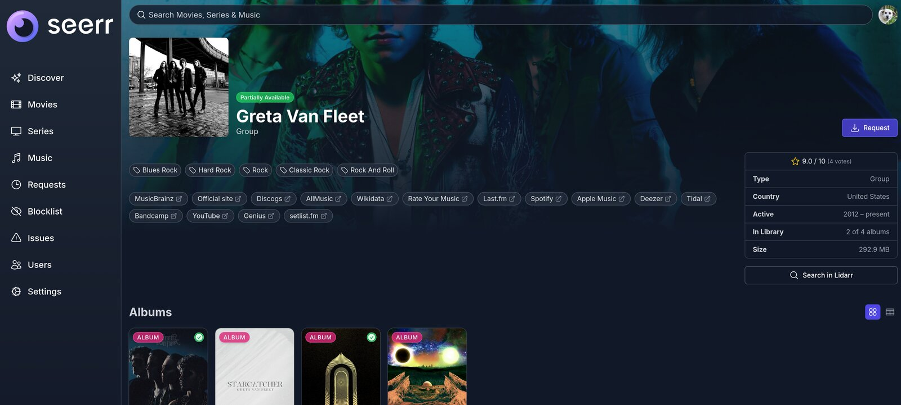
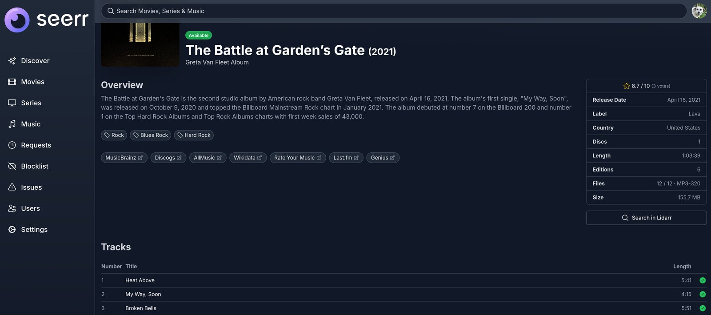
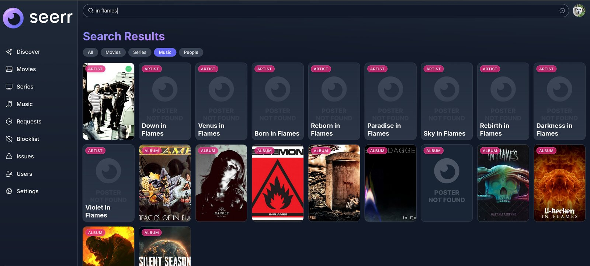

**This fork adds music to Seerr through [Lidarr](https://lidarr.audio/).** The list of all the major changes in comparison to the upstream:

- Lidarr server in *Settings > Services*; artist and album search, artist/album pages
- Artist page: albums newest first, as cards or as a sortable table (title, year, type, tracks, status; request on row hover)
- Album page: the track list of the album's canonical edition (the most common Official one), not a box set
- Artist and album pages: links out (MusicBrainz, Discogs, AllMusic, Last.fm, streaming services, official site), genre tags, rating, and a facts panel (country, active years, label, length, editions; files, quality and size of what Lidarr holds); tracks marked when Lidarr holds their file
- For users who manage requests: *Open in Lidarr* (set the Lidarr server's *External URL*) and *Search in Lidarr* on artist and album pages
- Request an album (only that album is monitored in Lidarr) or a whole artist (all its albums and future releases are monitored), with *Request Music* / *Auto-Approve Music* permissions
- Music requests in the *Requests* list and user profiles beside movies and series: approve, decline, retry
- Music statuses on cards and pages: Requested, Available, Partially Available (artist)
- Availability synced from Lidarr (*Lidarr Scan*: on save and every 30 min)
- *Music* menu and *Discover Music* page: Recently Added, Recent Music Requests, Similar to Your Library ([ListenBrainz](https://listenbrainz.org/)); Similar Artists on artist pages
- Music sliders can be added to the home page through *Customize Discover*
- Search type filter (All / Movies / Series / Music / People); kinds without a configured service are hidden; the search placeholder names the kinds shown (e.g. *Search Music*)
- The *Movies*, *Series* and *Music* items in the left menu appear only once the matching integration (Radarr, Sonarr, Lidarr) is added in *Settings > Services*

Image: `ghcr.io/maliavko/seerr-lidarr:latest`, built from `main-music` by GitHub Actions. Upstream: [seerr-team/seerr](https://github.com/seerr-team/seerr).
